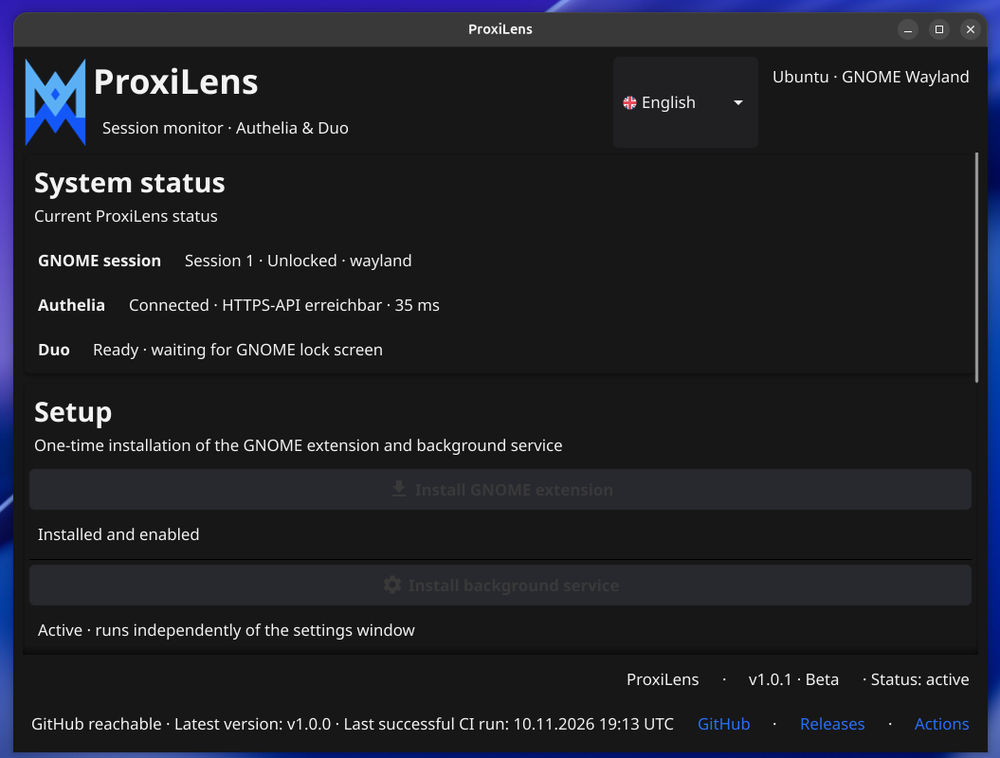

# ProxiLens 0.0.2 -- Alpha.7.3.1

ProxiLens is an experimental GNOME/Ubuntu prototype with an optional
user agent for Sleep/Wake handling and a Duo button on the GNOME lock
screen. The current test version is designed for Ubuntu with GNOME Shell
50.x in a Wayland user session.

> **Status:** Alpha/test software. The workflow described here has been
> tested on the project's target device (GNOME Shell 50.1, Wayland).
> This is not a general security guarantee for other systems or
> versions.



## Desktop settings window

ProxiLens includes a Fyne-based desktop window with the project logo,
Authelia connection settings, encrypted credential storage, and a live
GNOME session / Authelia status panel. The window can be opened from the
desktop status area when the desktop environment provides StatusNotifier
/ AppIndicator support. Closing the window hides it so the tray menu can
reopen it; use the tray menu's quit command to exit the UI.

Build the desktop UI and the background agent with:

```bash
go build -o dist/proxilens-ui ./cmd/proxilens-ui
go build -o dist/proxilens-wake-agent ./cmd/proxilens-wake-agent
```

## Current feature set

### GNOME lock screen and Duo button

-   The GNOME extension displays the **"Unlock with Duo"** button in
    `unlock-dialog`.
-   Clicking the button explicitly sends `DuoUnlockRequested` over the
    session D-Bus to the ProxiLens user agent.
-   The agent reads the stored Authelia credentials from the existing
    ProxiLens configuration store and requests authentication through
    Authelia/Duo.
-   After successful Duo confirmation, the agent checks again that the
    same active Wayland session is still locked, then requests
    `loginctl unlock-session` for that session.
-   On the tested device, the desktop was unlocked after successful Duo
    confirmation without requiring the Ubuntu password to be entered
    again.
-   GNOME reports transitions between `unlock-dialog` and `user`;
    `LockedHint` is also monitored through logind.

### Duo status display

The agent reports state changes back to the button:

1.  `LOCKED`
2.  `DUO_PENDING`
3.  `DUO_SUCCESS`
4.  `UNLOCK_REQUESTED`
5.  `UNLOCKED` -- only after GNOME reports leaving the unlock dialog
6.  `FAILED` -- if authentication or the unlock request fails

Alpha.7.3.1 centrally deduplicates these state notifications. If a GNOME
mode transition and the authentication workflow report the same state at
nearly the same time, the status is logged only once and sent to the
extension only once.

### Sleep/Wake

-   The user agent monitors logind `PrepareForSleep`.
-   After resume, network availability is checked again because DNS and
    network services may take some time to become available.
-   The Duo flow after Sleep/Wake proceeds only if the session is still
    locked.
-   Sleep/Wake handling is independent of clicking the Duo button
    manually.

## What ProxiLens does not change

-   No changes are made to `/etc/pam.d/*`, PAM, or GDM.
-   The normal GNOME lock-screen configuration is not changed.
-   No automatic Duo request is started by pressing `Super+L`; an
    explicit click on the button is required.
-   The session is not unlocked solely because of a GNOME status signal.
    Before unlocking, the agent checks the Authelia/Duo response and the
    current logind lock status.

## Requirements

-   Ubuntu with GNOME Shell 50.x (the extension installer checks for
    GNOME 50.x).
-   A Wayland user session.
-   `systemd-logind`, `loginctl`, `dbus-monitor`, and `gdbus`.
-   Go 1.26.0 or newer, as specified in `go.mod`.
-   An existing ProxiLens configuration containing the Authelia URL,
    Authelia username, and stored Authelia password.
-   A reachable Authelia instance and a configured Duo second factor.

## Installation / update

Keep the previously working version as a rollback copy. Extract the ZIP
into its own directory and run the following commands there:

``` bash
bash deploy/install-wake-agent.sh
bash deploy/install-gnome-extension.sh
systemctl --user restart proxilens-wake-agent.service
```

Check the extension status:

``` bash
gnome-extensions info proxilens-input@local
```

Follow the agent logs:

``` bash
journalctl --user -u proxilens-wake-agent.service -f
```

GNOME extensions may be reinitialized after updates or session-mode
changes. If the button does not appear, reload the extension:

``` bash
gnome-extensions disable proxilens-input@local
gnome-extensions enable proxilens-input@local
```

## Test procedure

1.  Press `Super+L` and check whether **"Unlock with Duo"** appears.
2.  Click the button.
3.  Approve the Duo push on your iPhone.
4.  Check that the desktop is unlocked without entering the Ubuntu
    password again.
5.  Test Sleep/Wake separately and verify that the existing Duo flow is
    preserved when the session remains locked.

Expected status sequence for the button workflow:

``` text
GNOME sessionMode: unlock-dialog active
Duo state: LOCKED
Duo state: DUO_PENDING
Duo state: DUO_SUCCESS
Duo state: UNLOCK_REQUESTED
GNOME sessionMode: user mode active
Duo state: UNLOCKED
```

Each state change should appear only once in the agent log. Depending on
timing, `GNOME sessionMode: user mode active` may appear immediately
before or after the final status notification.

## Security and operational limitations

-   This is an experimental unlock helper for an already logged-in,
    locked user session. It is not a PAM module and is not a replacement
    for authentication during system startup or at the GDM login screen.
-   The agent runs as a user process in the logged-in user's context.
    The session D-Bus is not a system-wide privileged authentication
    broker. A further security review is required before production use.
-   The GNOME button is inserted into private GNOME Shell interfaces
    (`Main.screenShield` and its dialog/clock widgets). GNOME updates
    may change these internal interfaces.
-   Network or DNS outages may delay or prevent the Duo workflow. On
    failure, the Duo workflow must not unlock the session; the regular
    GNOME unlock method remains available.
-   Credentials and personal server values must not be placed in source
    code, the README, logs, or public project archives.

## Uninstallation / rollback

Disable the GNOME extension:

``` bash
gnome-extensions disable proxilens-input@local
```

Stop and disable the user agent:

``` bash
systemctl --user disable --now proxilens-wake-agent.service
```

This alpha version does not modify PAM or GDM.

## Further documentation

-   [Alpha.7.3.1 -- Duo status and test
    guide](README-ALPHA7.3-DUO-STATE.md)
-   [Alpha.7 -- GNOME Duo button](README-ALPHA7-DUO-BUTTON-TEST.md)
-   [Sleep/Wake test](README-ALPHA6-TEST.md)
-   [Configuration](README-KONFIGURATION.md)

## License

ProxiLens is licensed under the MIT License.

Copyright (c) 2026 Michael Wlotkowski

See the [LICENSE](LICENSE) file for the full license text.

## GitHub status

The desktop dashboard checks the GitHub repository for the latest published release and the most recent successful GitHub Actions run. The status is refreshed every 10 minutes. Links to the repository, releases, and Actions are available in the application footer. If GitHub cannot be reached, the application continues to work and reports that the online status is unavailable.
