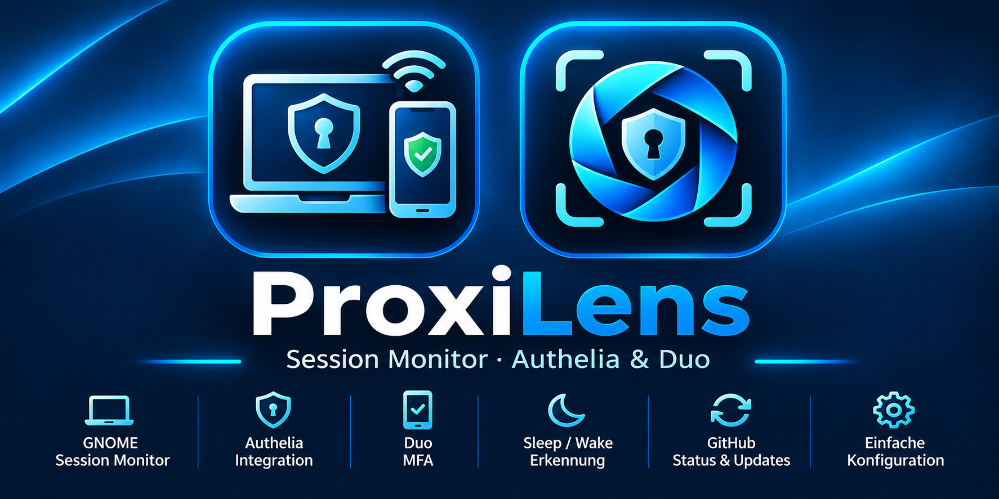
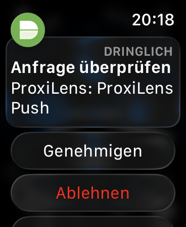
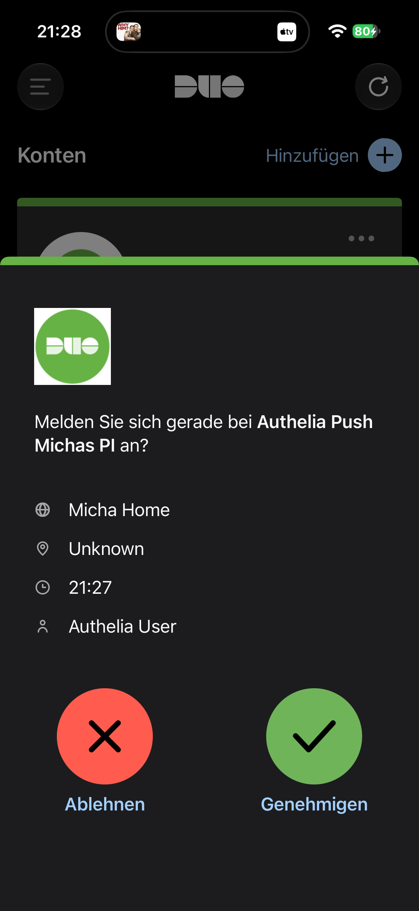

# ProxiLens

**An experimental GNOME lock-screen integration for Authelia and Duo,
with an optional Sleep/Wake user agent.**

ProxiLens is a prototype for Ubuntu systems running GNOME Shell 50.x in
a Wayland user session. It adds an explicit **Unlock with Duo** action
to the GNOME lock screen and uses an independent user-level agent to
handle the authentication request and session-unlock workflow.

> \[!WARNING\] **Alpha / experimental software.** The workflow has been
> tested on the project's target system (Ubuntu, GNOME Shell 50.1,
> Wayland). It is not a general security guarantee and has not been
> validated across all GNOME, Ubuntu, or hardware versions. Review the
> security limitations below before using it.

```{=html}
<p align="center">
```
``{=html}
```{=html}
</p>
```
## Screenshots

```{=html}
<p align="center">
```
``{=html}    ``{=html}
```{=html}
</p>
```
```{=html}
<p align="center">
```
`<em>`{=html}Apple Watch and iPhone views`</em>`{=html}
```{=html}
</p>
```
## Overview

### GNOME lock screen and Duo authentication

-   The GNOME Shell extension adds an **Unlock with Duo** button to the
    `unlock-dialog`.
-   The user must explicitly click the button to start the Duo workflow.
-   The extension sends a `DuoUnlockRequested` signal to the ProxiLens
    user agent over the session D-Bus.
-   The agent loads the existing Authelia connection settings and stored
    credentials from the ProxiLens configuration store.
-   The agent requests authentication through Authelia and Duo.
-   After successful Duo confirmation, the agent verifies that the same
    active Wayland session is still locked.
-   Only then does it request `loginctl unlock-session` for that
    session.
-   On the tested system, the desktop unlocked after successful Duo
    confirmation without requiring the Ubuntu password to be entered
    again.

The agent also observes GNOME session-mode transitions (`unlock-dialog`
and `user`) and the logind `LockedHint` property.

### Duo status reporting

The agent reports the workflow state to the GNOME extension:

1.  `LOCKED`
2.  `DUO_PENDING`
3.  `DUO_SUCCESS`
4.  `UNLOCK_REQUESTED`
5.  `UNLOCKED` --- after GNOME reports that the session has left the
    unlock dialog
6.  `FAILED` --- if authentication or the unlock request fails

In Alpha.7.3.1, state notifications are centrally deduplicated. If a
GNOME mode transition and the authentication workflow report the same
state at nearly the same time, the state is logged and sent to the
extension only once.

### Authentication latency

When the user clicks the lock-screen button, the agent starts the HTTPS
authentication request immediately. It does not run a separate DNS/TCP
preflight first; the HTTPS request itself establishes the connection.

The Sleep/Wake path retains its network-readiness retry loop because DNS
and network services may still be starting after resume. Password
validation, Duo enrollment verification, Duo Push confirmation, and the
final locked-session checks are unchanged.

## Sleep/Wake handling

-   The user agent monitors logind's `PrepareForSleep` signal.
-   After resume, network availability is checked again because DNS and
    network services may need time to become available.
-   The Duo flow after resume proceeds only if the session is still
    locked.
-   Sleep/Wake handling is independent of manually clicking the Duo
    button.

## Desktop settings application

ProxiLens includes a Fyne-based desktop application for configuring the
Authelia connection and viewing GNOME session, Authelia, Duo,
installation, and GitHub status.

The settings window is launched as a normal desktop application. It is
not required to remain open for the background agent to operate. The
`proxilens-wake-agent.service` systemd user service runs independently
of the settings window.

The application supports three interface languages:

-   German
-   English
-   Spanish

The selected language is saved in the application preferences.

## Linux architectures

The project supports these Linux architectures when the corresponding
CI/release workflows are enabled:

-   `linux/amd64` --- Intel and AMD 64-bit systems
-   `linux/arm64` --- 64-bit ARM systems, including compatible Raspberry
    Pi models

Published GitHub releases may provide a separate archive and SHA-256
checksum for each architecture. Check the **Releases** page for the
assets available for a particular release.

## Requirements

-   Ubuntu with GNOME Shell 50.x. The GNOME extension installer checks
    for GNOME 50.x.
-   A Wayland user session.
-   `systemd-logind`, `loginctl`, `dbus-monitor`, and `gdbus`.
-   Go **1.27 or newer**, as specified by `go.mod`, when building from
    source or installing the agent from source.
-   An existing ProxiLens configuration containing the Authelia URL,
    username, and stored Authelia password.
-   A reachable Authelia instance and a configured Duo second factor.
-   For the desktop UI build, the Linux development libraries required
    by Fyne (see the CI workflow for the Ubuntu package list).

## Installation and updates

### Option A: Install from the desktop application

Open ProxiLens and use the two setup actions:

1.  **Install GNOME extension**
2.  **Install background service**

The application downloads the current source archive from this
repository's default branch and runs the corresponding installer script.
A local Git checkout is not required for these setup actions.

The Wake Agent installer requires the Go version specified in `go.mod`
and the required system tools, including `dbus-monitor`.

### Option B: Run the installer scripts manually

If you have cloned or extracted the project, open a terminal in the
project directory and run:

``` bash
bash deploy/install-wake-agent.sh
bash deploy/install-gnome-extension.sh
systemctl --user restart proxilens-wake-agent.service
```

Keep a copy of the previously working version before updating so that
you can roll back if needed.

### Verify the GNOME extension

``` bash
gnome-extensions info proxilens-input@local
```

### Follow the agent log

``` bash
journalctl --user -u proxilens-wake-agent.service -f
```

GNOME extensions may need to be reinitialized after updates or
session-mode changes. If the Duo button does not appear, try:

``` bash
gnome-extensions disable proxilens-input@local
gnome-extensions enable proxilens-input@local
```

## Build from source

Install the Linux development dependencies listed in
[`.github/workflows/ci.yml`](.github/workflows/ci.yml), then build both
binaries from the repository root:

``` bash
mkdir -p dist
go build -trimpath -o dist/proxilens-ui ./cmd/proxilens-ui
go build -trimpath -o dist/proxilens-wake-agent ./cmd/proxilens-wake-agent
```

Run the test suite with:

``` bash
go test ./...
```

## Test procedure

1.  Press `Super+L` and confirm that **Unlock with Duo** appears on the
    GNOME lock screen.
2.  Click **Unlock with Duo**.
3.  Approve the Duo Push request on your enrolled device.
4.  Confirm that the desktop unlocks after successful Duo authentication
    without asking for the Ubuntu password again.
5.  Test Sleep/Wake separately.
6.  Confirm that the existing Duo workflow is preserved after resume
    when the session is still locked.

Expected status sequence for the manual button workflow:

``` text
GNOME sessionMode: unlock-dialog active
Duo state: LOCKED
Duo state: DUO_PENDING
Duo state: DUO_SUCCESS
Duo state: UNLOCK_REQUESTED
GNOME sessionMode: user mode active
Duo state: UNLOCKED
```

Each state change should appear only once in the agent log. Depending on
timing, `GNOME sessionMode: user mode active` may appear immediately
before or after the final status notification.

## What ProxiLens does not change

-   It does not modify `/etc/pam.d/*`, PAM, or GDM.
-   It does not replace the normal GNOME lock-screen configuration.
-   Pressing `Super+L` does not automatically start a Duo request; the
    user must explicitly click the Duo button.
-   A GNOME status signal alone does not authorize an unlock. The agent
    checks the Authelia/Duo result and the current logind lock status
    before requesting the unlock.

## Security and operational limitations

> \[!CAUTION\] ProxiLens is an experimental unlock helper for an already
> logged-in, locked user session. It is **not** a PAM module and is
> **not** a replacement for authentication at system startup or at the
> GDM login screen.

-   The agent runs as a user process in the logged-in user's context.
    The session D-Bus is not a system-wide privileged authentication
    broker.
-   The agent requests `loginctl unlock-session` after successful
    Authelia/Duo authentication and a locked-session check. This design
    requires further security review before production use.
-   The GNOME extension interacts with private GNOME Shell interfaces,
    including `Main.screenShield` and its dialog/clock widgets. GNOME
    updates may change these internal interfaces and break
    compatibility.
-   Network or DNS outages may delay or prevent Duo authentication. A
    failed Duo workflow must not unlock the session; the regular GNOME
    unlock method remains available.
-   Do not put passwords, tokens, Duo secrets, private server values, or
    other credentials in source code, this README, logs, or public
    project archives.
-   Use this prototype only if you understand its limitations and have a
    working alternative way to access your system.

## Uninstallation and rollback

Disable the GNOME extension:

``` bash
gnome-extensions disable proxilens-input@local
```

Stop and disable the user agent:

``` bash
systemctl --user disable --now proxilens-wake-agent.service
```

This alpha version does not modify PAM or GDM. If you kept a backup of
the previous installation, restore it according to your local setup
procedure.

## GitHub status in the desktop application

The desktop dashboard checks this repository for the latest published
release and the most recent successful GitHub Actions run. The status is
refreshed every 10 minutes. Links to the repository, releases, and
Actions are available in the application footer.

If GitHub cannot be reached, the desktop application continues to work;
only the online repository status is unavailable.

## Further documentation

-   [Alpha.7.3.1 --- Duo status and test
    guide](README-ALPHA7.3-DUO-STATE.md)
-   [Alpha.7 --- GNOME Duo button](README-ALPHA7-DUO-BUTTON-TEST.md)
-   [Sleep/Wake test](README-ALPHA6-TEST.md)
-   [Configuration guide](README-KONFIGURATION.md)

## License

ProxiLens is licensed under the [MIT License](LICENSE).

Copyright (c) 2026 Michael Wlotkowski.
